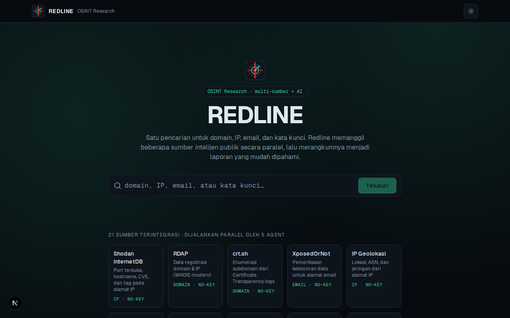
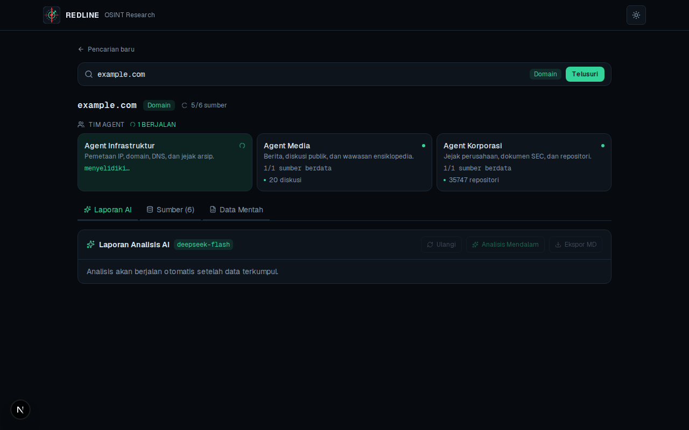

<div align="center">

# Redline

**OSINT research in a single search — multi-source, AI-summarized.**

Query a domain, IP, email, phone number, username, or keyword once. Redline fans out to
21 public-intelligence sources in parallel, streams results to the UI as they arrive, then
turns the raw findings into a coherent intelligence report with DeepSeek.

[](https://nextjs.org)
[](https://www.typescriptlang.org)
[](https://tailwindcss.com)
[](./LICENSE)
[](#contributing)

</div>

---

## Screenshots

> **Live Demo:** _coming soon_

| Landing | Results & Agents | AI Report |
| --- | --- | --- |
|  |  |  |

_Add your screenshots to `assets/` (or `public/`) and update the paths above._

---

## Highlights

- **21 integrated sources** — infra, DNS, breach, media, corporate, and identity data from
  public APIs (20 require no key at all).
- **One search bar, automatic classification** — the input is classified as `domain`, `ip`,
  `email`, `phone`, `username`, or `keyword`, and only the relevant sources are queried.
- **5-agent orchestration** — sources are grouped into Infra, Leak, Media, Corporate, and
  Identity agents that run in parallel and report per-agent progress.
- **Real-time streaming** — results arrive as a newline-delimited JSON (NDJSON) stream; each
  source reports independently so one slow or failing source never blocks the whole search.
- **AI intelligence report** — DeepSeek streams a structured report (executive summary, key
  findings, cross-source correlation, next steps) with strict anti-hallucination guardrails.
- **Normal & Deep analysis modes** — pick `deepseek-flash` for speed or a deeper model for
  on-demand analysis.
- **Cache with per-type TTL** — Upstash Redis in production, in-memory fallback in dev.
- **Per-IP rate limiting** — Upstash sliding-window in production, in-memory fallback in dev.
- **Markdown export, local history, and dark mode** — export any report, revisit recent
  searches from `localStorage`, switch themes.

---

## Architecture

```
[ User input ]
      │
      ▼
[ Classify query ]  ──►  domain | ip | email | phone | username | keyword
      │
      ▼
[ Plan agents ]  ──►  Infra · Leak · Media · Corporate · Identity
      │
      ▼
POST /api/search  ──►  fan-out adapters in parallel (per-source timeout)
      │                       │
      │                       ▼
      │            NDJSON stream: meta → agent → source → done
      ▼
[ UI renders results gradually, tabbed per category ]
      │
      ▼
POST /api/analyze  ──►  DeepSeek (stream: true)
      │                    system prompt: anti-hallucination + fixed format
      ▼
[ AI report streamed token-by-token ]
```

**Stream events** (`application/x-ndjson`): `meta`, `agent`, `source`, `notice`, `done`,
`error`.

---

## Tech Stack

| Layer | Technology |
| --- | --- |
| Framework | Next.js 16.4 (App Router, Cache Components, Partial Prefetching) |
| Language | TypeScript (strict) |
| UI | React 19.3 · Tailwind CSS v4 · lucide-react · class-variance-authority |
| AI | DeepSeek via the `openai` SDK (OpenAI-compatible) |
| Cache & Rate limit | Upstash Redis (optional; in-memory fallback) |
| Validation | Zod |
| Testing | Vitest |
| Runtime & tooling | Bun 1.4 · ESLint (flat config) · Turbopack |
| Deployment | Vercel |

---

## OSINT Sources

All sources are public and keyless except **Numverify**, which is optional (auto-skipped
when `NUMVERIFY_API_KEY` is not set).

| Source | Category | Supports | Auth |
| --- | --- | --- | --- |
| Shodan InternetDB | IP | `ip` | no-key |
| RDAP | Domain | `domain`, `ip` | no-key |
| crt.sh | Domain | `domain` | no-key |
| DNS (Cloudflare DoH) | Domain | `domain`, `email` | no-key |
| Wayback Machine | Domain | `domain` | no-key |
| XposedOrNot | Email | `email` | no-key |
| Gravatar | Email | `email` | no-key |
| IP Geolocation (ipwho.is) | IP | `ip` | no-key |
| RIPEstat | IP | `ip` | no-key |
| GDELT | Keyword | `keyword` | no-key |
| Wikidata | Keyword | `keyword` | no-key |
| SEC EDGAR | Keyword | `keyword` | no-key |
| Hacker News | Keyword | `keyword`, `domain`, `username` | no-key |
| GitHub Search | Keyword | `keyword`, `domain` | no-key |
| Wikipedia | Keyword | `keyword` | no-key |
| Stack Exchange | Keyword | `keyword` | no-key |
| GitHub User | Identity | `username` | no-key |
| GitLab User | Identity | `username` | no-key |
| Keybase | Identity | `username` | no-key |
| Phone Info | Identity | `phone` | no-key |
| Numverify | Identity | `phone` | api-key |

---

## Agents

| Agent | Mandate | Sources |
| --- | --- | --- |
| **Infra** | Map IP, domain, DNS, and archive footprint. | Shodan InternetDB, RDAP, crt.sh, IP Geolocation, RIPEstat, DNS DoH, Wayback |
| **Leak** | Detect leaked data and email-linked profiles. | XposedOrNot, Gravatar |
| **Media** | News, public discussion, and encyclopedic insight. | GDELT, Wikidata, Hacker News, Wikipedia, Stack Exchange |
| **Corporate** | Company footprint, SEC filings, and repositories. | SEC EDGAR, GitHub Search |
| **Identity** | Account profiles and identity enumeration. | GitHub User, GitLab User, Keybase, Phone Info, Numverify |

---

## Getting Started

### Prerequisites

- [Bun](https://bun.sh) 1.4.2 (primary) — or `pnpm` as a fallback
- Node.js 22+

### Setup

```bash
git clone https://github.com/faridhafizh/redline.git
cd redline
bun install

cp .env.example .env.local   # then fill in the values you need (see below)

bun run dev
```

Open [http://localhost:3000](http://localhost:3000).

> **Search works without any API keys.** `DEEPSEEK_API_KEY` is only required for the AI
> analysis feature; Upstash and Numverify are optional.

---

## Environment Variables

| Variable | Required | Purpose |
| --- | --- | --- |
| `DEEPSEEK_API_KEY` | For AI reports | DeepSeek API key (server-side only). |
| `DEEPSEEK_BASE_URL` | No | Defaults to `https://api.deepseek.com`. |
| `DEEPSEEK_MODEL` | No | Normal-mode model. Defaults to `deepseek-flash`. |
| `DEEPSEEK_MODEL_PRO` | No | Deep-mode model. Defaults to `deepseek-v4-pro`. |
| `NEXT_PUBLIC_DEEPSEEK_MODEL` | No | Model label shown in the UI (must match `DEEPSEEK_MODEL`). |
| `NEXT_PUBLIC_DEEPSEEK_MODEL_PRO` | No | Deep-mode label shown in the UI. |
| `NUMVERIFY_API_KEY` | No | Enables the Numverify phone source; skipped when unset. |
| `UPSTASH_REDIS_REST_URL` | No | Enables Redis-backed cache and rate limiting. |
| `UPSTASH_REDIS_REST_TOKEN` | No | Token for the Upstash Redis instance. |

> **Never** prefix secrets with `NEXT_PUBLIC_` — only the model *labels* above are public.

---

## Scripts

All commands run from the repository root.

| Command | Description |
| --- | --- |
| `bun run dev` | Start the dev server (Turbopack) at http://localhost:3000 |
| `bun run build` | Production build |
| `bun run start` | Serve the production build |
| `bun run lint` | ESLint (flat config) |
| `bun run typecheck` | `tsc --noEmit` |
| `bun run test` | Run the Vitest suite once |
| `bun run test:watch` | Run Vitest in watch mode |
| `bun run scripts/smoke-osint.ts` | Live smoke test against all 21 OSINT adapters |

---

## API Reference

### `POST /api/search`

Runs the fan-out and returns an NDJSON stream (`application/x-ndjson`).

```jsonc
// request
{ "query": "example.com" }
```

Events emitted: `meta` (classified type, sources, agents, cache hit), `agent` (progress),
`source` (per-source `success` / `empty` / `error`), `notice` (external-tool fallback),
`done`, `error`. Rate limit: **20 requests/min per IP**.

### `POST /api/analyze`

Streams a DeepSeek intelligence report as `text/plain`.

```jsonc
// request
{
  "query": "example.com",
  "type": "domain",
  "mode": "normal",        // "normal" | "deep"
  "results": [ /* SourceResult[] from /api/search */ ]
}
```

Returns `503` when `DEEPSEEK_API_KEY` is not configured. Rate limit: **10 requests/min per
IP**.

---

## Project Structure

```
app/
  api/
    search/route.ts          # fan-out OSINT fetch → NDJSON stream
    analyze/route.ts         # DeepSeek streaming analysis
  search/[query]/page.tsx    # results page (Suspense-wrapped)
  layout.tsx                 # theme + fonts + metadata
  page.tsx                   # landing page + search bar
components/                  # SearchBar, SearchResults, AIReport, SourceCard, ...
lib/
  agents.ts                  # agent definitions + planning + summaries
  analysis.ts                # system prompt + prompt sanitization
  classify.ts                # query type detection & normalization
  deepseek.ts                # OpenAI-compatible DeepSeek client
  cache.ts                   # Upstash / in-memory cache + TTLs
  ratelimit.ts               # Upstash / in-memory rate limiting
  export.ts                  # Markdown report export
  history.ts                 # localStorage search history
  osint/                     # one adapter per source + registry + http/throttle helpers
scripts/smoke-osint.ts       # live adapter smoke test
```

---

## Security

- API keys are **server-side only** (never `NEXT_PUBLIC_`).
- All request payloads are validated with **Zod**.
- **Per-IP rate limiting** on both API routes.
- **Prompt-injection defense**: OSINT data is sanitized and wrapped in a `<DATA>` block; the
  model is instructed to treat it as data, not instructions.
- **Security headers** (`X-Content-Type-Options`, `X-Frame-Options`, `Referrer-Policy`,
  `Permissions-Policy`), `poweredByHeader` disabled, and browser source maps off.

---

## Deployment (Vercel)

1. Import the repository into Vercel (framework preset: **Next.js**), or run `vercel`.
2. Set the environment variables you need (`DEEPSEEK_API_KEY`, optional Upstash and Numverify
   keys) in the project settings.
3. Build command `bun run build`, install command `bun install`.
4. Ensure **Fluid Compute** is enabled — the streaming route handlers set
   `maxDuration = 60`.

---

## Disclaimer

Redline queries **open, public data sources only** and its output is **indicative**, not
authoritative. Use it ethically and only against targets you are authorized to investigate.
You are responsible for complying with all applicable laws and the terms of service of each
data source.

---

## Contributing

Issues and pull requests are welcome. Before opening a PR, run:

```bash
bun run lint && bun run typecheck && bun run test
```

---

## License

Released under the [MIT License](./LICENSE). © 2026 Muhammad Farid Hafizh.
